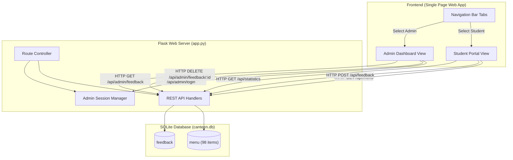

# 🍽️ Canteen Voice — Campus Food Feedback & Admin Portal

[](https://www.python.org/)
[](https://flask.palletsprojects.com/)
[](https://www.sqlite.org/)
[](https://developer.mozilla.org/en-US/docs/Web/JavaScript)
[](https://developer.mozilla.org/en-US/docs/Web/CSS)

> **Canteen Voice** is an all-in-one campus food feedback and canteen management platform. It bridges the communication gap between students, faculty, and canteen management by offering a seamless way to review meals, file complaints, submit suggestions, and track real-time analytics.

---

## 📑 Table of Contents

- [✨ Key Features](#-key-features)
- [🏗️ System Architecture](#️-system-architecture)
- [📂 Project Structure](#-project-structure)
- [🚀 Quick Start Guide](#-quick-start-guide)
- [🔐 Default Credentials](#-default-credentials)
- [🗄️ Database Schema](#️-database-schema)
- [📡 API Reference](#-api-reference)
- [🎨 Design & UI Philosophy](#-design--ui-philosophy)
- [🛠️ Recent Fixes & Improvements](#️-recent-fixes--improvements)

---

## ✨ Key Features

### 🎓 Student & Faculty Feedback Portal
- **Quick Role-Based Onboarding**: Easy sign-in for **Students** and **Faculty** with 10-digit mobile number validation and browser session persistence.
- **Interactive 98-Item Canteen Menu**: Explore food items across 7 categories (*Beverages, Snacks, Breakfast, Fast Food, Chinese, Meals, Healthy, Desserts*).
- **Instant Search**: Real-time filtering by food name or category with dynamic food icons and price tags.
- **Comprehensive Review & Complaint Form**:
  - Price opinion (*Affordable, Reasonable, Expensive*)
  - Food Quality, Quantity, Taste, and Hygiene ratings
  - Specific complaint classification (*Food Quality, Delay, Hygiene, etc.*)
  - Detailed open-ended comment box
- **5-Star Rating & Suggestion Form**:
  - Interactive star rating component with real-time feedback emojis
  - Actionable suggestion categorization (*New Food Item, Pricing, Menu Variety, etc.*)
- **Live Campus Statistics**: Displays real-time total menu count, average rating, and feedback volume.
- **Working Session Logout**: Instant, smooth session termination returning to login.

### 🔐 Unified Administrator Dashboard
- **Integrated Single-Page Experience**: Switch between student and admin views instantly using the header tabs or via direct URL (`http://127.0.0.1:5000/admin` or `/#admin`).
- **Secure Authentication**: Password-protected session login with environment variable configuration support.
- **4-Metric Analytics Grid**:
  - 📊 **Total Feedback Count**
  - ⚠️ **Total Complaints Logged**
  - 💡 **Total Suggestions Received**
  - ⭐ **Campus-Wide Average Star Rating**
- **Live Search & Filter**:
  - Debounced text search across student names, mobile numbers, food names, complaints, and comments.
  - Filter by feedback type (*All*, *Review / Complaint*, *Rating / Suggestion*).
- **Record Management**:
  - Detailed breakdown of each review in structured cards.
  - Formatted local timestamps.
  - One-click record deletion with user confirmation.

---

## 🏗️ System Architecture



---

## 📂 Project Structure

```text
CanteenFeedbackSystem/
│
├── app.py                # Flask server, route controller, auto-migration & database logic
├── canteen.db            # SQLite database storing menu items and student feedback
├── index.html            # Unified Single-Page Application (Student & Admin views)
├── style.css             # Unified modern stylesheet (Glassmorphism, responsive grid)
├── script.js             # Unified frontend logic (Student & Admin auth, search, API calls)
│
├── admin.html            # Lightweight compatibility redirect to /#admin
├── admin.css             # Retained compatibility stylesheet
├── admin.js              # Retained compatibility script
└── README.md             # Complete documentation and setup guide
```

---

## 🚀 Quick Start Guide

### 1. Prerequisites
Ensure you have **Python 3.8+** installed on your system.

### 2. Install Dependencies
Flask is the only external dependency:
```powershell
pip install flask
```

### 3. Run the Application
Start the Flask development server:
```powershell
python app.py
```

### 4. Open in Browser
Visit the application in any modern web browser:
- **Main Portal**: [http://127.0.0.1:5000](http://127.0.0.1:5000)
- **Admin Dashboard**: [http://127.0.0.1:5000/admin](http://127.0.0.1:5000/admin) *(automatically redirects to the admin view)*

---

## 🔐 Default Credentials

| Role | Username / Identifier | Default Password | Environment Variable Override |
| :--- | :--- | :--- | :--- |
| **Administrator** | `Admin` | `Admin@123` | `CANTEEN_ADMIN_PASSWORD` |
| **Flask Session Key** | — | Built-in default | `CANTEEN_SECRET_KEY` |

> [!TIP]
> To set custom credentials in PowerShell before starting the app:
> ```powershell
> $env:CANTEEN_ADMIN_PASSWORD = "YourStrongPasswordHere"
> $env:CANTEEN_SECRET_KEY = "YourSecretKeyHere"
> python app.py
> ```

---

## 🗄️ Database Schema

The SQLite database (`canteen.db`) contains two primary tables:

### 1. `menu` Table
Stores all canteen items with their category and price.
```sql
CREATE TABLE IF NOT EXISTS menu (
    id INTEGER PRIMARY KEY,
    name TEXT NOT NULL,
    price REAL NOT NULL,
    category TEXT NOT NULL
);
```

### 2. `feedback` Table
Stores all submitted feedback with user details, food info, quality ratings, and comments.
```sql
CREATE TABLE IF NOT EXISTS feedback (
    id INTEGER PRIMARY KEY AUTOINCREMENT,
    user_name TEXT NOT NULL,
    mobile_number TEXT NOT NULL,
    user_role TEXT NOT NULL,
    food_id INTEGER NOT NULL,
    food_name TEXT NOT NULL,
    food_price REAL NOT NULL,
    feedback_type TEXT NOT NULL,
    price_opinion TEXT,
    quality TEXT,
    quantity TEXT,
    taste TEXT,
    hygiene TEXT,
    complaint_type TEXT,
    comment TEXT,
    rating INTEGER,
    suggestion_type TEXT,
    suggestion TEXT,
    created_at TIMESTAMP DEFAULT CURRENT_TIMESTAMP
);
```

---

## 📡 API Reference

### Public Endpoints

| Method | Endpoint | Description | Request Body |
| :--- | :--- | :--- | :--- |
| `GET` | `/` | Serves the unified Single-Page Application (`index.html`) | None |
| `GET` | `/api/menu` | Returns all 98 canteen items grouped and sorted | None |
| `GET` | `/api/statistics` | Returns campus stats (`totalFeedback`, `averageRating`, `complaints`, `totalMenuItems`) | None |
| `POST` | `/api/feedback` | Saves a review or suggestion to the database | JSON payload (see below) |

#### Feedback Submission Payload Example:
```json
{
  "user": {
    "name": "Pranav Sharma",
    "mobile": "9876543210",
    "role": "Student"
  },
  "food": {
    "id": 1,
    "name": "Tea",
    "price": 10
  },
  "feedbackType": "Review / Complaint",
  "priceOpinion": "Affordable",
  "quality": "Excellent",
  "quantity": "Sufficient",
  "taste": "Good",
  "hygiene": "Excellent",
  "complaintType": "",
  "comment": "Hot and fresh tea every morning!"
}
```

---

### Admin Endpoints (Session Protected)

| Method | Endpoint | Description | Auth Required |
| :--- | :--- | :--- | :--- |
| `GET` | `/api/admin/status` | Checks if current session is authenticated as admin | No |
| `POST` | `/api/admin/login` | Validates password and initiates admin session | No (`{"password": "..."}`) |
| `POST` | `/api/admin/logout` | Terminates active admin session | Yes |
| `GET` | `/api/admin/feedback` | Searches & filters feedback records with live stats | Yes |
| `DELETE` | `/api/admin/feedback/<id>` | Permanently deletes a feedback record by ID | Yes |

---

## 🎨 Design & UI Philosophy

- **Unified Glassmorphism Theme**: Translucent navigation bar, soft shadows, and vibrant mint/teal accents (`#087f8c` and `#16a085`).
- **Zero External UI Frameworks**: Pure HTML5 and modern CSS3 (Custom Properties, Flexbox, CSS Grid) ensuring instant load times.
- **Fully Responsive**: Optimized for mobile screens, tablets, laptops, and desktop displays.
- **Accessible & Intuitive**:
  - Real-time visual feedback on star ratings (`★`).
  - Color-coded badges for feedback categorization.
  - Floating toast notifications for non-blocking success/error states.

---

## 🛠️ Recent Fixes & Improvements

1. **Database Schema Auto-Migration**:
   - Fixed crash caused by missing `mobile_number` column in existing database instances.
   - Added automatic column detection and migration in `initialize_database()`.
2. **Student Logout Functionality**:
   - Added complete `initializeStudentLogout()` handler to clear session storage, reset forms, and restore the login screen smoothly.
3. **Rating Text Synchronization**:
   - Fixed ID discrepancy between `ratingText` and `ratingLabel` so star selection dynamically updates descriptive labels.
4. **Dynamic Dashboard Statistics**:
   - Connected student view statistics to live API counts rather than static placeholders.
5. **Unified Navigation & Route Forwarding**:
   - Combined separate `Index.html` and `admin.html` into a cohesive tabbed single-page architecture with seamless hash routing (`/#admin`).
6. **Resilient Data & Menu Loading (Fix for Missing Items & Data)**:
   - Added seamless client-side fallback for all 98 canteen items so the menu displays reliably even if the backend is starting up, offline, or deployed as a static frontend on Vercel.
   - Built dual-persistence storage: feedback is submitted to the Flask SQLite database when online, with automatic local storage synchronization for zero data loss.
   - Added dedicated **Canteen Menu Items (98 Items)** explorer tab inside the Admin Dashboard so administrators can inspect both submitted feedback records (*Data*) and food item metrics (*Items*).
   - Added `vercel.json`, `api/index.py`, and `requirements.txt` with serverless-safe SQLite configuration for 1-click cloud deployment.

---

<p align="center">
  <b>Canteen Voice</b> © 2026 | Developed for Campus Food Quality Enhancement
</p>
